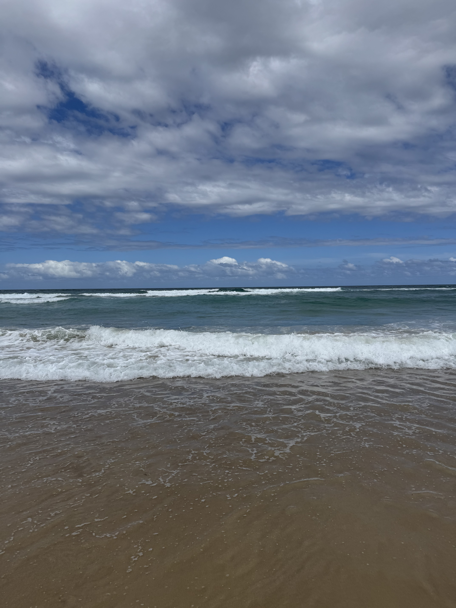
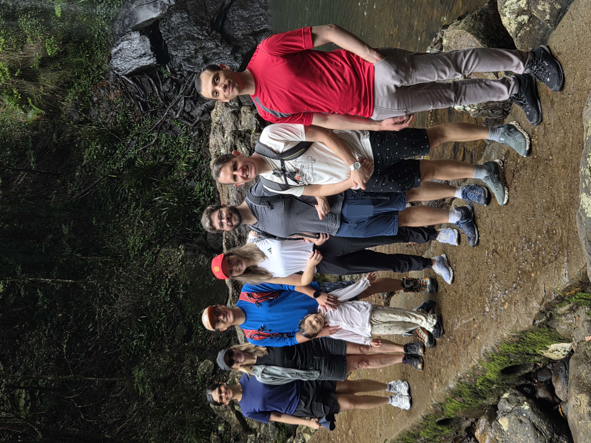
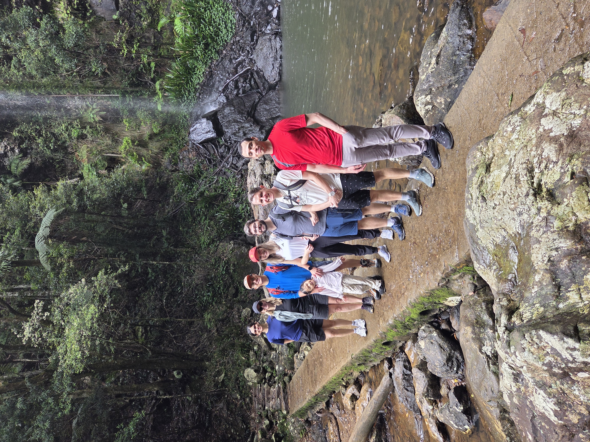
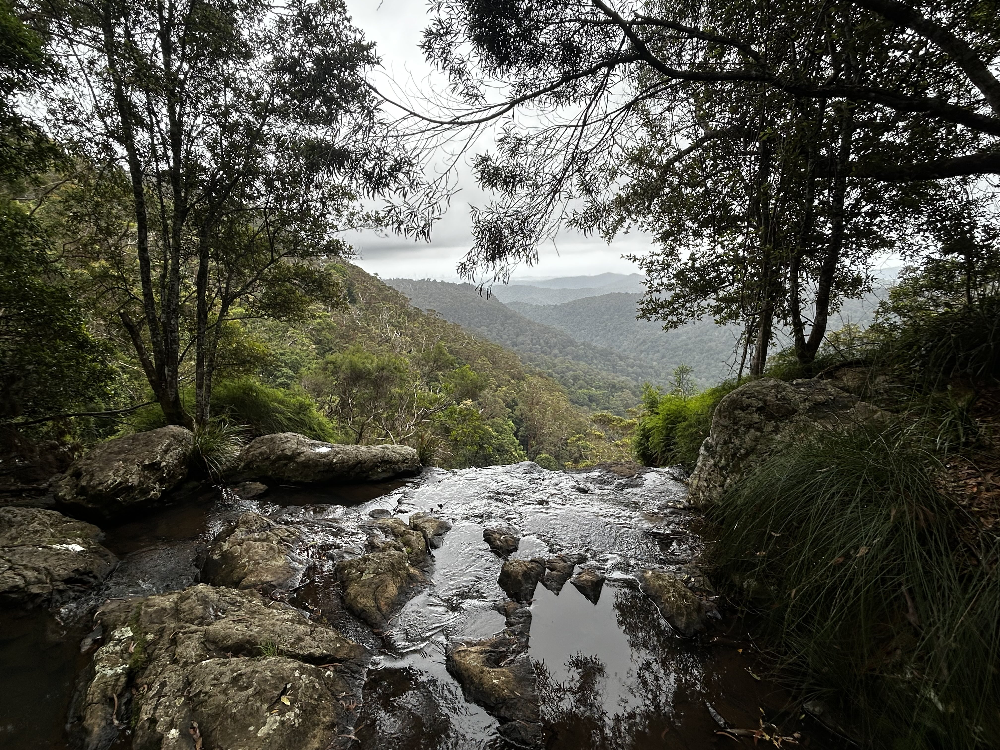

To wrap up the year, the ASCI lab headed out for a day trip to Springbrook National Park and Broadbeach on the Gold Coast, joined by two visiting researchers!

We started the day with a scenic hike to the [Twin Falls waterfall](https://www.queensland.com/au/en/plan-your-holiday/journeys/p-56b2624b7b935fbe730e20f1-twin-falls-circuit-springbrook-national-park) in Springbrook National Park, followed by coffee and lunch together, and a relaxing walk along Broadbeach.
It was a wonderful opportunity to enjoy the outdoors and spend some time together outside the lab. The weather cooperated too. 

A lovely way to round off the year, and here's to more lab adventures in 2027!

<figure style="text-align: center; margin: 20px auto;">
<table style="width: 100%; table-layout: fixed; border: none; border-collapse: separate; border-spacing: 8px;">
<tr>
<td style="width: 50%; padding: 0; border: none;">

</td>
<td style="padding: 0; border: none;">

</td>
</tr>
<tr>
<td style="padding: 0; border: none;">

</td>
<td style="width: 50%; padding: 0; border: none;">

</td>
</tr>
</table>
<figcaption style="font-size: 0.9em; color: #777; margin-top: 8px;">
📸 ASCI lab end-of-year outing to Springbrook and Broadbeach.
</figcaption>
</figure>
